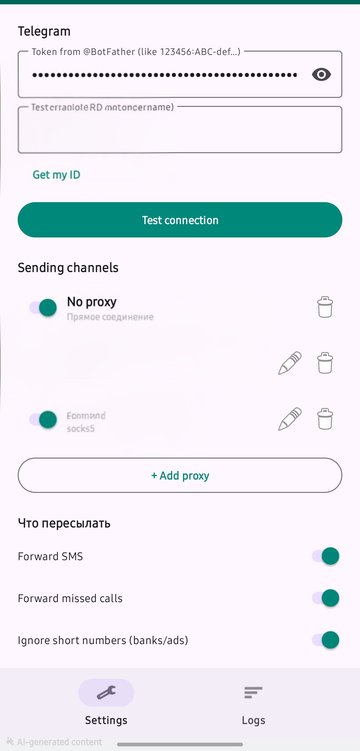

# 📱 SMS Forwarder — Android → Telegram

> Пересылает входящие/исходящие SMS, пропущенные/принятые/исходящие звонки, «не дозвонился»,
> события батареи и шаги зарядки с Android в Telegram.
> Работает в фоне **без всплывающих уведомлений**, не выгружается системой.
> Поддержка HTTP/SOCKS5 прокси для обхода блокировок.


---

## 📸 Скриншот



---

## 🚀 Возможности

- 📩 **Входящие SMS** — мгновенно, с именем отправителя из контактов
- 📤 **Исходящие SMS** — пересылает отправленные сообщения (через ContentObserver)
- 📵 **Пропущенные вызовы** — только реально не отвеченные (RINGING→IDLE без OFFHOOK)
- 📞 **Принятые входящие звонки** — когда вы ответили на вызов (RINGING→OFFHOOK→IDLE)
- 📞 **Исходящие звонки** — когда вы сами звоните (OFFHOOK без RINGING→IDLE)
- ❌ **«Не дозвонился»** (#166): исходящий вызов без соединения отправляется в Telegram отдельным сообщением (❌, без длительности); в истории — новый тип с фильтром «Звонки»
- 🔋 **События батареи** (#161): опциональная пересылка в Telegram при достижении порога полного заряда (80–100%) и/или низкого заряда (0–30%); оба порога настраиваются слайдерами в настройках, события идут через общий сервис (очередь, ретраи) и попадают в историю (тип «батарея», 🔋). Анти-спам: событие — один раз при переходе порога, повтор — после выхода за порог обратно. Настройки включены в экспорт/импорт бэкапа
- ⚡️ **Шаги зарядки** — пересылка изменений уровня заряда (например, 57%→67%) с указанием напряжения (4.3V); при доступности — с током зарядки (0.98A); чтение тока через рефлексию (BatteryManager.EXTRA_CURRENT не резолвится в compile-окружении)
- 🚫 **Ничего лишнего** — никаких локальных оповещений и аналитики, только пересылка
- 🌙 **Работает в фоне** — автозапуск после перезагрузки, защита от выгрузки (Doze/Exemption)
- 🔒 **Токен в приложении** — вводите в UI, хранится в EncryptedSharedPreferences (AES-256)
- 🌐 **Многоканальная отправка** — «Без прокси» + неограниченное число HTTP/SOCKS5 прокси
- 🔄 **Каскадные ретраи** — пробует каналы по порядку, экспоненциальный бэкофф 15с→30с→60с (кап 10 мин), суммарно ~15 мин; порядок каналов настраивается сам: успешный поднимается наверх, неудачный уходит вниз
- ⏰ **Тихие часы** — расписание, когда события не отправляются (может пересекать полночь)
- 📜 **История событий** — вкладка с сохранёнными SMS/вызовами/батареей (Room); клик по событию — полные детали: кому (Chat ID), через какого бота (@username), канал, попытки и полный текст отправленного сообщения; фильтр по типу: «SMS», «Звонки» (включает missed/incoming/outgoing), отдельные типы событий
- 📊 **Вкладка «Логи»** — INFO/OK/WARN/ERROR, in-memory буфер последних 200 записей; поиск по тексту + фильтр по уровню
- 📦 **Экспорт/импорт настроек** — JSON backup через SAF, privacy-first (секреты не попадают в файл; включает настройки звонков, батареи)
- ⬆️ **Автообновления** — проверка GitHub Releases при запуске (не чаще раза в сутки), ручная кнопка; выбор APK по архитектуре устройства (Build.SUPPORTED_ABIS)
- 🎨 **Темы** — светлая / тёмная / по системе
- 🎨 **Акцентные цвета** — бирюзовый, зелёный, красный, синий, фиолетовый, оранжевый, серый
- ⏹️ **Полная остановка** (#157): одна кнопка-toggle «Запустить/Остановить» — состояние сервиса видно в приложении (forwardingEnabled); раньше были две отдельные кнопки без индикации текущего состояния. «Стоп» (#153) останавливает пересылку до явного «Запустить» — ресиверы (SMS, звонки, исходящие SMS, автозапуск) проверяют флаг перед постановкой события; новое SMS не возобновляет пересылку без ведома пользователя
- ✂️ **Длинные сообщения** — автоматическая нарезка на части по лимиту Telegram 4096 символов
- 🧩 **Панели интерфейса** — «Каналы» и «История» выделены в отдельные компоненты, MainActivity — тонкая склейка
- 🔒 **Пароли прокси** — в EncryptedSharedPreferences, миграция из v0.4.x
- 📱 **SIM для звонков на dual-SIM** (#153): `{sim}` в сообщениях о звонках берётся из subscription-экстры PHONE_STATE-интента, а не «первая активная SIM»

---

## 📥 Установка

Скачайте последний **release APK** со страницы [Releases](https://github.com/ozyab09/sms-forwarder/releases).

> ⚠️ Приложение не в Google Play — установите APK вручную (разрешите «Неизвестные источники»).

---

## ⚙️ Быстрый старт (3 шага)

### 1. Создайте бота
Откройте [@BotFather](https://t.me/BotFather) в Telegram → `/newbot` → получите **токен** (вроде `123456789:ABC...`).

### 2. Введите токен в приложении
Откройте SMS Forwarder → вставьте токен → нажмите **«Проверить связь»**.

### 3. Получите Chat ID
Напишите боту `/start` → в приложении нажмите **«Получить мой ID»** → готово!

---

## 🔧 Настройки (вкладка «Настройки»)

| Настройка | Описание |
|-----------|----------|
| **Токен бота** | Обязательно. Из @BotFather. Хранится в EncryptedSharedPreferences. |
| **Chat ID** | Ваш числовой ID. Кнопка «Получить мой ID» заберёт его через getUpdates (фильтр по `chat.type=private`). |
| **Каналы отправки** | «Без прокси» (всегда) + HTTP/SOCKS5 прокси. Порядок = приоритет каскада (динамический: promote-on-success, demote-on-failure). |
| **Прокси-канал** | Тип (HTTP/SOCKS5), хост, порт, логин/пароль (пароль — в EncryptedSharedPreferences). SOCKS5 с логином/паролем не поддерживается. |
| **Переключатели** | Вкл/выкл: входящие SMS, исходящие SMS, пропущенные вызовы, принятые входящие, исходящие звонки, «не дозвонился», события батареи. |
| **Статус** | Одна кнопка «Запустить»/«Остановить» — видно, работает пересылка или нет. «Стоп» останавливает до следующего «Запустить» (мастер-выключатель). |
| **Тихие часы** | Интервал (в т.ч. через полночь), когда пересылка не выполняется. |
| **Батарея** | Пороги для событий: полный заряд (80–100%) и низкий заряд (0–30%); слайдеры в настройках. |
| **История** | Вкладка с последними событиями (SMS/вызовы/батарея), хранятся локально в Room; фильтр по типу, поиск по тексту. |
| **Темы** | Светлая / тёмная / по системе + акцентные цвета (во вкладке «О приложении»). |
| **Автообновления** | Проверка при запуске (раз в сутки) + кнопка «Проверить обновления» в «О приложении». |

---

## 🛡️ Приватность и безопасность

- **SMS, звонки, батарея не покидают телефон** — только через ваш бот в Telegram
- **Токен зашифрован** — `EncryptedSharedPreferences` (AES-256)
- **Всё локально** — логи (кольцевой буфер 200 записей) и история событий хранятся только на устройстве и никуда не отправляются
- **Секреты не в бэкапе** — экспорт настроек не включает токен и пароли прокси
- **Нет аналитики, трекеров, рекламы**
- **Нет двусторонней пересылки** — ответы из Telegram в SMS не реализованы (privacy-first)

---

## 📦 Сборка (для разработчиков)

Требования: **JDK 17**, **Android SDK 34**.

```bash
# Debug APK (для тестов):
./gradlew assembleDebug

# Тесты + линтер:
./gradlew testDebugUnitTest lintDebug

# Release APK (подписанный; секреты через env):
./gradlew assembleRelease
```

---

## 🔄 CI/CD (GitHub Actions)

| Событие | Что происходит |
|---------|----------------|
| Pull Request | Debug APK + unit-тесты + lint (обязательная зелёная проверка) |
| Merge в main | Автоматическое создание тега по версии из `gradle/libs.versions.toml` (без bump-коммита из-за branch protection) |
| Тег `vX.Y.Z` | Unit-тесты → подписанный Release APK → GitHub Release |

Версию вычисляет CI из последнего тега: patch+1 по умолчанию, `feat:` в коммитах → minor+1, `BREAKING CHANGE`/`!:` → major+1. Автор бампит версию в том же PR, где фича/фикс. `versionCode` = `major*10000 + minor*100 + patch`.

**Секреты репозитория** (Settings → Secrets → Actions):

| Секрет | Назначение |
|--------|-----------|
| `KEYSTORE_BASE64` | Keystore для подписи (base64) |
| `KEYSTORE_PASSWORD` | Пароль keystore |
| `KEY_ALIAS` | Алиас ключа |
| `KEY_PASSWORD` | Пароль ключа |

---

## 🏗️ Архитектура (кратко)

```
UI (MainActivity — тонкий вид, 4 вкладки) → MainViewModel (StateFlow/SharedFlow)
        │
        ├── Prefs: DataStore (plain) + EncryptedSharedPreferences (секреты)
        ├── ChannelStore / ChannelSender → TelegramClient → Bot API (HTTPS + proxy)
        │
SmsReceiver / CallReceiver / OutgoingSmsObserver / BootReceiver
        │
ForwardService (Foreground, START_STICKY, type dataSync)
        ├── SendQueue (FIFO + min-heap ретраев, per-event backoff)
        ├── EventQueueStore (атомарная персистентность очереди на диск)
        ├── EventHistory (Room) + вкладка «История» (фильтры, поиск, детали)
        └── ChannelSender → ChannelClientFactory (кэш OkHttp) → Bot API
        │
BatteryMonitor (рефлексия для чтения тока из sticky ACTION_BATTERY_CHANGED)
        └── события батареи и шаги зарядки → очередь → Telegram
```

---

## 🛡️ Права доступа

`RECEIVE_SMS` · `READ_PHONE_STATE` · `READ_CALL_LOG` · `READ_CONTACTS` ·
`INTERNET` · `FOREGROUND_SERVICE` · `FOREGROUND_SERVICE_DATA_SYNC` ·
`RECEIVE_BOOT_COMPLETED` · `REQUEST_IGNORE_BATTERY_OPTIMIZATIONS`

> `POST_NOTIFICATIONS` (Android 13+) не запрашивается — FGS-канал `IMPORTANCE_MIN`,
> пользователь может отключить канал вручную в настройках.

---

## 📁 Структура проекта

```
sms-forwarder/
├── app/src/main/java/com/ozyab/smsforwarder/
│   ├── ui/          # MainActivity (4 tabs), MainViewModel (MVVM), OnboardingActivity,
│   │                #   ChannelsPanel, HistoryPanel (делегаты)
│   ├── receiver/    # SmsReceiver, CallReceiver, BootReceiver
│   ├── service/     # ForwardService (FGS, queue, retries), SendQueue, EventQueueStore
│   ├── telegram/    # Channel, ChannelStore, ChannelClientFactory, ChannelSender, TelegramClient
│   ├── history/     # Room: EventDao, EventDatabase, EventHistory (вкладка «История»)
│   ├── update/      # UpdateChecker, UpdateManager (GitHub Releases, выбор по ABI)
│   └── util/        # Prefs, LogStore, ThemeManager, QuietHours, SettingsBackup,
│                      TemplateFormatter, BatteryMonitor, SimInfo, ContactNames,
│                      ReceiverExecutor
├── app/src/main/res/           # layout, strings (ru/en), themes, icons
├── app/src/test/               # unit-тесты (JUnit + Robolectric, ~182 теста, 0 пропускаются)
├── gradle/                     # wrapper, libs.versions.toml (версия приложения через теги)
├── .github/workflows/build.yml # CI/CD (PR: debug+tests+lint; main: auto tag; tag: release)
├── docs/
│   ├── TECH_TASK.md            # полное ТЗ (актуализировано)
│   ├── BRAINSTORM.md           # архив идей
│   └── screenshots/            # app.png
├── ROADMAP.md                  # план работ + карта покрытия тестами
├── AGENTS.md                   # документация для разработчиков
├── CHANGELOG.md
└── README.md
```

---

## 💡 Идеи для дальнейшего развития

| Идея | Описание | Сложность | Статус |
|------|----------|-----------|--------|
| **Экспорт/импорт настроек** | Backup JSON (секреты не пишутся) — уже реализовано | Низкая | ✅ v0.4.22 |
| **Расписание/тихие часы** | Не слать в заданные интервалы | Низкая | ✅ v0.4.23 |
| **ViewModel + MVVM** | Логика вынесена из MainActivity, состояние переживает поворот | Средняя | ✅ v0.4.24 |
| **Детали события в истории** | Полный текст, Chat ID, бот, канал — по клику на событие | Низкая | ✅ v0.4.32 |
| **Мульти-бот** | Несколько ботов с разными Chat ID (разные получатели) | Средняя | ❌ не планируется |
| **Групповые уведомления** | Telegram-группы/супергруппы (topic_id для форумов) | Низкая | ⏳ |
| **Web UI для логов** | Встроенный веб-сервер (NanoHTTPD) для просмотра логов с ПК | Средняя | ⏳ |
| **Дублирование каналов** | Параллельная отправка в 2+ ботов одновременно | Средняя | ❌ удалено (v0.5.22 — не работало: нет разных Chat ID для каналов) |
| **Push-уведомления на телефон** | Локальные уведомления при получении SMS/вызова | Низкая | ❌ удалено (v0.6.7 — не используется) |
| **Поиск по логам** | Фильтр по уровню/тексту/времени во вкладке «Логи» | Низкая | ✅ v0.5.0 |
| **Статистика** | Графики: SMS/день, успешность по каналам, latency | Средняя | ⏳ |
| **MQTT / Webhook** | Альтернативные каналы доставки (Home Assistant, n8n) | Высокая | ⏳ |
| **F-Droid публикация** | Автосборка и публикация (требует reproducible builds) | Высокая | ⏳ |
| **Kotlin Multiplatform** | iOS версия (общий core) | Очень высокая | ⏳ |
| **Hilt (DI)** | Тестируемость, жизненный цикл, чистота кода | Средняя | ⏳ кандидат |
| **WorkManager** | Надёжная фоновая работа вместо FGS | Средняя | ⏳ отложено (FGS + START_STICKY + очередь покрывают) |
| **Двусторонняя пересылка** | Ответ из Telegram → исходящий SMS | Высокая | ❌ отклонено (privacy-first, attack surface) |
| **Webhook (HTTP POST)** | Отправка на произвольный URL | Средняя | ❌ отклонено (scope — только Telegram) |

---

## 📝 Формат сообщений

### Входящее SMS
```
📩 SMS [2026-09-07 21:35]
От: +7 900 123-45-67 (Имя)
---------------------------------------------------------------
Текст сообщения…
```

### Исходящее SMS
```
📤 Исходящее SMS [2026-09-07 21:36]
Кому: +7 900 123-45-67 (Имя)
---------------------------------------------------------------
Текст сообщения…
```

### Пропущенный вызов
```
📵 Пропущенный [2026-09-07 21:33]
От: +7 900 123-45-67 (Имя)
```

### Принятый входящий звонок
```
📞 Входящий звонок [2026-09-07 21:33]
От: +7 900 123-45-67 (Имя)
Длительность: 5 мин 23 сек
```

### Исходящий звонок
```
📞 Исходящий звонок [2026-09-07 21:33]
Кому: +7 900 123-45-67 (Имя)
Длительность: 5 мин 23 сек
```

### «Не дозвонился»
```
❌ Не дозвонился [2026-09-07 21:33]
Кому: +7 900 123-45-67 (Имя)
```

### Событие батареи (низкий заряд)
```
🔋 Низкий заряд [2026-09-07 21:33]
Заряд: 15%
```

### Событие батарея (полный заряд)
```
🔋 Полный заряд [2026-09-07 21:33]
Заряд: 85%
```

### Шаг зарядки
```
⚡️ Зарядка: 57%→67% (4.3V) [14:31:03]
```
или с током (если доступен):
```
⚡️ Зарядка: 57%→67% (4.3V, 0.98A) [14:31:03]
```

---

_Документация актуальна на 2026-11-07_
